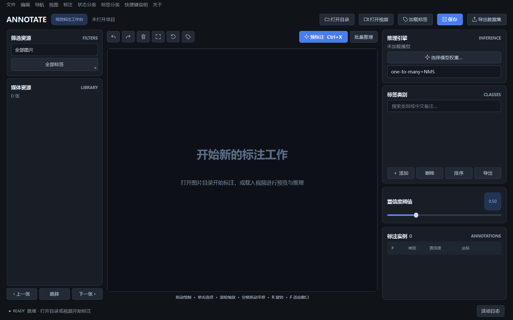

# 目标检测标注工具 (label_for_detect)

基于 Python + PySide6 / Qt 的桌面端目标检测标注工具，支持 YOLO 格式标注、YOLO 预标注、按分类筛选图片，以及常用标注编辑操作。默认使用深色现代工作台，图片、视频和标注保存逻辑沿用稳定版本。



## 功能概览

- **图片管理**：打开目录递归扫描图片，缩略图列表，上一张/下一张/跳转
- **标注编辑**：绘制、移动、缩放、删除锚框；撤销/重做；多选与框选
- **标签管理**：加载 `classes.txt` 或按子文件夹名导入；支持导出标签文件
- **分类筛选**：全部 / 已标注 / 未标注 / 不确定（手动分类可持久化）
- **预标注**：单图预标注、按当前筛选批量预标注（YOLO / Ultralytics）
- **视频推理**：完整逐帧推理后播放检测框与置信度，支持暂停、进度定位与倍速
- **导出**：YOLO、COCO、Pascal VOC 数据集，以及带检测框、类别名和置信度的 MP4 视频
- **会话恢复**：记住上次打开的目录与图片位置

## 环境要求

- Windows 10/11，使用 64 位 Python。
- Python 3.10+；当前维护环境使用 Python 3.13。建议为本项目创建独立的虚拟环境。
- CPU 即可进行图片标注、视频播放和导出，也可运行 `.pt` / `.onnx` 模型预标注；NVIDIA GPU 与 CUDA 用于可选的推理加速。
- 如需切换旧版界面或运行 Tk 相关测试，Python 安装时需保留 Tcl/Tk 和 `tkinter` 组件；它们不通过 `pip` 安装。

## 环境依赖

运行依赖统一由 [requirements.txt](requirements.txt) 管理，安装时以该文件为准：

| 依赖包 | 版本要求 | 用途 |
|--------|----------|------|
| `ultralytics` | `>=8.0.0` | YOLO 模型加载，图片、批量图片及视频逐帧推理 |
| `Pillow` | `>=10.0.0` | 图片读取、显示和导出时绘制标注文字 |
| `opencv-python` | `>=4.8.0` | 视频解码、帧读取及图像格式转换，导入名为 `cv2` |
| `imageio-ffmpeg` | `>=0.6.0` | 为带框视频导出提供 FFmpeg 编码器和音轨处理 |
| `PySide6-Essentials` | `>=6.8,<7` | 现代 Qt 界面的 Core / Gui / Widgets，导入名为 `PySide6` |
| `PyYAML` | `>=6.0` | 读取 YAML 标签集，导入名为 `yaml` |
| `onnxruntime` | `>=1.16.0` | ONNX 模型推理，默认安装 CPU 版本 |

`NumPy`、`torch`、`torchvision` 等传递依赖会随 OpenCV / Ultralytics 一起由 `pip` 解析并安装；无需为普通 CPU 使用额外安装 CUDA。使用 YOLO26 等较新模型时，Ultralytics 版本还需支持对应的权重格式。

可选环境按实际用途配置：

| 用途 | 额外要求 |
|------|----------|
| `.pt` 模型使用 NVIDIA GPU | 安装显卡驱动，并按 [PyTorch 官方安装页面](https://pytorch.org/get-started/locally/) 选择与环境匹配的 CUDA 版 PyTorch / torchvision |
| `.onnx` 模型使用 NVIDIA GPU | 按 ONNX Runtime 的 [CUDA 安装说明](https://onnxruntime.ai/docs/execution-providers/CUDA-ExecutionProvider.html) 配置 `onnxruntime-gpu` 及匹配的 CUDA / cuDNN；CPU 与 GPU 版 Runtime 不应同时安装 |
| `.engine` / `.trt` 模型 | NVIDIA GPU、相匹配的 CUDA / TensorRT 环境及 TensorRT Python 包；TensorRT 不属于默认安装依赖 |
| 打包 Windows EXE | `PyInstaller`；`build_exe.bat` 会自动安装该打包依赖，日常运行无需单独安装 |

视频导出所用的 FFmpeg 可执行程序由 `imageio-ffmpeg` 提供，无需另外安装系统 FFmpeg 或配置其 PATH。

## 安装与运行

在 PowerShell 中进入项目目录，创建独立环境后安装并启动：

```powershell
git clone https://github.com/sle1008/label_for_detect.git
cd label_for_detect
python -m venv .venv
.\.venv\Scripts\python.exe -m pip install --upgrade pip
.\.venv\Scripts\python.exe -m pip install -r requirements.txt
.\.venv\Scripts\python.exe main.py
```

如果已经下载项目，直接在现有项目目录从创建虚拟环境这一步开始。上述命令直接使用虚拟环境中的 Python，无需先运行激活脚本。

如已激活 Conda / venv 环境，也可在同一个终端中运行：

```powershell
python -m pip install -r requirements.txt
python main.py
```

Windows 下也可双击 `start.bat` 或 `start.vbs` 无控制台启动；启动脚本使用 PATH 中的 Python，该解释器也需要安装上述依赖。使用项目内 `.venv` 时，推荐直接运行 `.\.venv\Scripts\python.exe main.py`，确保安装和启动使用同一环境。

### 环境检查与缺包提示

启动时会检查上述 7 项运行依赖；缺失时弹出“运行环境不完整”提示并列出缺少的包。请用实际启动软件的 Python 安装依赖，例如：

```powershell
.\.venv\Scripts\python.exe -m pip install -r requirements.txt
.\.venv\Scripts\python.exe -m pip check
```

`python -m pip check` 用于检查已安装包之间的依赖是否匹配。使用虚拟环境之外的解释器启动时，也应以该解释器执行安装和检查命令。若提示找不到 `tkinter`，需通过 Python 安装程序补装 Tcl/Tk 组件。

### 界面与使用方式

新版布局分为左侧资源与筛选、中间标注画布、右侧推理引擎 / 标签类别 / 标注实例。拖动分隔线可调整面板宽度；底部“活动日志”可查看操作记录。文件选择、类别备注、统计、快捷键说明和导出窗口均使用 Qt 控件。文件和目录选择窗口支持在顶部地址栏粘贴路径后按回车或点击“转到”直接跳转；首次鼠标点击地址框会全选并显示最多 5 条最近目录，选择历史目录可直接跳转，再次点击可定位光标编辑。Ctrl+L / Alt+D 也可定位并全选地址栏，深浅色外观跟随应用主题。地址栏及历史下拉限制宽度，长路径优先显示末尾；完整路径仍可编辑、复制和跳转，悬停可查看全部内容。

文件选择弹窗及其标准菜单、确认提示使用中文。顶部保留地址输入、转到和后退 / 前进 / 上级目录；在文件列表空白处右键可新建文件夹、切换列表 / 详细视图或显示隐藏文件，在文件项上右键还可重命名、删除。

媒体资源的图片数量后显示当前打开目录的末级名称，悬停可查看完整路径；筛选按钮与“上一张 / 下一张”采用相同行高。

“视图”菜单可切换深色 / 浅色主题，立即生效并记住选择。状态与类别筛选、权重与推理模式采用横向布局，置信度阈值使用单行显示。所有画布及视频的图标按钮都有悬停文字提示。资源列表支持 Ctrl 点击多选 / 取消和 Shift 连选；点击列表标题旁的“刷新”或按 F5 可重新扫描当前目录，保留当前类别和筛选条件。

顶部操作从左侧开始排列，“预标注 / 批量推理”位于“加载标签”和“保存”之间，右栏从顶部起排；图片、类别及标注实例采用紧凑行高。编辑栏使用图标加文字，“前框 / 后框”（Q / E）位于最前面，窄窗口自动换行。带快捷键的操作会在悬停提示中说明快捷键；保存、预标注采用普通按钮样式，选中项采用蓝底白字。Ctrl+O 打开目录，F5 刷新列表。

现代界面的类别列表字号略大，前框 / 后框按钮直接显示 Q / E，选中底色及右键菜单行距也更轻巧。大目录会先显示扫描到的首批 64 条文件名预览，后台继续扫描、排序和准备索引；完整列表就绪后即可正常选择和标注。最终排序、筛选和上次位置恢复规则保持一致。

标签缓存按图片目录复用标签位置和文件索引，减少逐图重复查询；读取仍在后台进行，结果分批合并，并以当前会话中的标注修改为准。刷新或重新打开目录时重建索引。

现代画布对 IoU（交并比）达到 85% 的同类或不同类别框显示重复提示：未选中框线加粗 1 像素，组内标签集中展示，图像右上角以黑字白边显示“有x个重复框”。数量按每组成员数减一计算，删除、撤销或调整框后即时更新，没有重复时隐藏。点击图片空白处后按 Tab 在全部标注框中循环；单选一个重复框后按 Tab 则只在该组内循环。也可点击框上方的类别文字选中对应实例，再按 Delete 删除，Ctrl 点击标签支持加选或取消。标签保持原行高，优先利用画布空间显示完整类别名称，超长文本再省略。提示仅用于预览复核，不自动删除或更改标注，也不写入导出文件。

可选参数：

```bash
python main.py --dir "D:/images" --weights "model.pt"
```

“视图 → 切换到旧版界面外观”会自动保存图片标注并重新打开原 Tk 界面，旧版“视图”菜单可切回现代界面。切换期间保持单实例；保存失败时保留当前窗口，推理 / 导出 / 加载期间需等待任务完成。界面重开后视频需重新打开和推理；同一 Qt 窗口内切换深浅主题则保留视频缓存与播放状态。下次启动沿用选择的界面，也可用 `python main.py --legacy-ui` 或 `python main.py --modern-ui` 强制指定本次启动界面。框架选择和迁移说明见 [现代界面说明](docs/modern-ui.md)。

Windows 下两种界面分别设置原生 DPI 感知，旧版从配置恢复或从现代界面切入时均启用系统 DPI，避免系统放大窗口导致字体发虚。

## 标注文件说明

- 标注保存为同名 `.txt`（YOLO 格式：`class_id cx cy w h`）。目录包含 `images` 层级时优先保存到对应的 `labels` 目录，其余图片保存到图片旁；读取时兼容已有标注位置。
- **已标注**：存在 `.txt`（可为空文件，表示背景/负样本）
- **未标注**：无 `.txt`
- **不确定**：根目录 `.annotation_status.json` 中记录（仅此状态需要额外文件）

每次打开目录时，只查找当前目录直属的 TXT：先按文件名识别包含 `class` 的文件（不区分大小写，优先 `classes.txt`、`class.txt`），再检查其他至少含一行 `id: 类别名` 的文件。含坐标、混合格式、重复编号或无效内容的文件会跳过；按名称匹配的标签集也支持一行一个类别名。未找到时清空类别，等待手动加载；不再恢复目录绑定、历史标签文件或会话中的旧类别，也不自动按子文件夹名导入。刷新列表保留当前类别，重新打开目录则重新识别。

标签集自动读取仅访问源文件，不删除或改写内容。识别为标签集的 TXT 即使与图片同名，也不会随图片删除、清空标注或移动导出而被删除；保存图片标注若与标签集路径冲突，会报错并保留原文件。

手动点击“加载标签 → 从文件导入”时，文件选择窗口默认打开当前图片目录。TXT / YAML 文件及按子文件夹名导入仍可手动选择。

## 视频推理与播放

1. 点击“打开视频”（或 `Ctrl+Shift+O`），读取视频后停在首帧；也可先播放原视频预览。
2. 加载预标注权重、设置阈值，再按 `Ctrl+X` 对视频每一帧推理。状态栏显示进度，全部完成后提示“视频推理完成”。推理期间可用工具栏的“停止”取消。
3. 点击“播放”，即可查看带检测框、类别名和置信度的画面。左键单击视频画面可切换播放/暂停，画面外的留白及图片模式不响应此播放操作。暂停会停在当前画面；拖动进度条后，播放中的视频继续播放，已暂停的视频保持暂停。
4. 进度条右侧可选择 `1x`、`1.25x`、`1.5x`、`2x`。倍速切换不改变暂停状态，也不重新执行推理。
5. 点击播放控制栏的“导出视频”，选择 MP4 保存路径。尚未推理时会先完成整个视频的推理，再自动导出；已有完整结果则直接导出。推理期间也可通过视频右键菜单提前选择导出路径，等待推理结束后自动导出。
6. 视频模式下按 `,`（逗号）查看上一帧，按 `.`（句号）查看下一帧，或使用视频右键菜单中的“上一帧 / 下一帧”。逐帧操作会暂停在目标帧，检测框和置信度随帧同步；到达首帧或末帧后不再越界。状态栏显示当前帧号。

打开的视频路径会显示在左侧图片列表最上方并选中。点击图片可返回图片标注，再点击视频条目可返回视频，保留其会话内的完整推理结果。视频条目和视频画面均支持右键菜单：“从列表中删除”（保留原文件）、“删除视频”（确认后从磁盘删除）、“上一帧”、“下一帧”、“播放原视频”、“推理视频”（等同 `Ctrl+X`）、“导出视频”。“播放原视频”直接播放不叠加检测框的原始画面，无需执行推理；已有推理缓存仍保留并用于带框导出，原视频模式下可通过“播放标注视频”切回带框画面。图片的列表索引、筛选、多选和右键操作保持原有行为。

结果按原始帧号缓存在当前会话中；从列表移除、打开其他视频或重启程序后需重新推理。修改阈值或更换权重后，按 `Ctrl+X` 重新推理以应用新设置。推理失败或取消时不使用不完整的结果，也不会继续导出。

导出使用原视频分辨率和帧率，保留原音轨（如有），不受预览倍速影响；不会覆盖原视频。编码器随依赖安装，无需单独安装系统 FFmpeg。导出期间可继续浏览图片或播放视频，完成后状态栏提示保存位置。

## 常用快捷键

| 快捷键 | 功能 |
|--------|------|
| Ctrl+O | 打开目录 |
| Ctrl+Shift+O | 打开视频 |
| F5 | 刷新当前图片目录（现代界面） |
| , / .（逗号 / 句号） | 视频上一帧 / 下一帧，暂停在目标帧（仅视频模式，输入框内不触发） |
| Ctrl+S | 保存当前图标注 |
| Ctrl+Shift+S | 导出数据集 |
| Ctrl+Z / Ctrl+Y | 撤销 / 重做 |
| Delete | 删除选中锚框 |
| ←/→ 或 A/D | 上一张 / 下一张 |
| Ctrl+G | 跳转到指定图片 |
| Ctrl+X | 预标注当前图；视频模式下对完整视频逐帧推理 |
| Ctrl+Shift+X | 批量预标注（按当前分类筛选） |
| F | 适应窗口 |
| R | 当前图片旋转 180°（再次按下恢复；标注坐标同步映射） |
| T | 切换标签显示（全部 → 精简 → 隐藏） |
| Tab | 现代画布中点击图片空白处后遍历全部框，点击重复框后只遍历该组 |
| 1~9 | 快速选择标签类别 |

切换图片、关闭程序时会自动保存当前图的标注变更。

## 项目结构

```
├── main.py              # 入口
├── core/                # 数据模型、项目状态、撤销重做
├── io_ops/              # 读写标注、预标注、导出
├── ui/                  # 界面组件
├── utils/               # 常量、几何、颜色等工具
├── tests/               # 单元测试
├── build.spec           # PyInstaller 打包配置（可选）
└── requirements.txt
```

## 打包为 exe（可选，本地使用）

```bash
build_exe.bat
```

生成的 `dist/`、`build/` 目录已在 `.gitignore` 中忽略，不会提交到仓库。

## 运行测试

```bash
python -m unittest discover -s tests -p "test_*.py"
```

## 许可证

本项目代码供个人学习与内部使用。使用前请自行确认数据集与模型权重的授权。
