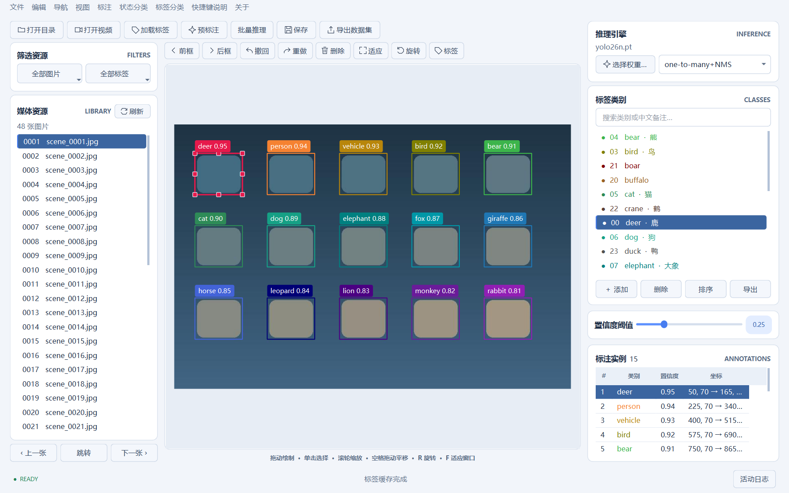

# 现代界面

默认界面使用 PySide6 / Qt Widgets，深色底色、蓝色强调色和统一线性图标。主窗口、画布、菜单、文件选择和各类对话框均由 Qt 实现，不嵌入 Tk 窗口。

## 框架选择

以下是常见的现代桌面界面方案，适用性取决于项目语言和交互类型。

| 框架 | 主要特点 | 对本项目的适用性 |
| --- | --- | --- |
| [PySide6 / Qt](https://doc.qt.io/qtforpython-6/) | Python 官方 Qt 绑定，成熟的桌面控件、原生绘图、高分屏支持 | 可直接复用 Python 推理与数据处理，适合标注画布和桌面文件工作流，采用此方案 |
| [Flutter](https://flutter.dev/) | 跨平台、自绘控件、动画和视觉一致性较好 | 界面自由度高，需要 Dart 与 Python 的进程通信 |
| [Tauri + React / Vue](https://v2.tauri.app/) | 使用网页技术开发界面，系统 WebView 和 Rust 后端 | 适合 Web 团队，需要建立 Python 推理与画布之间的通信边界 |
| [Electron](https://www.electronjs.org/) | Web 生态成熟，跨平台、界面定制灵活 | 开发资源丰富，运行时体积和内存成本较高，同样需要 Python 通信 |
| [WinUI 3](https://learn.microsoft.com/windows/apps/winui/winui3/) / [WPF](https://learn.microsoft.com/dotnet/desktop/wpf/) | Windows 桌面生态，与系统集成深入 | 适合以 C# 为主的 Windows 产品，本项目需额外维护 Python 接口 |

Qt 的选择主要基于现有 Python 工程、密集鼠标编辑、视频解码和本地文件管理。画布使用 QPainter；大量图片使用 QListView 与模型，不为每张图片创建单独控件。

## 使用方式

```bash
pip install -r requirements.txt
python main.py
```

`start.bat` / `start.vbs` 使用同一默认入口。`--dir`、`--labels`、`--weights` 参数继续可用。

左侧提供图片分类和类别筛选、虚拟资源列表及独立视频条目。中间集中放置标注工具和画布，打开视频后显示时间线、倍速和导出控件。右侧为模型、类别搜索 / 备注、阈值和标注实例表格。面板可拖动调整，底部可展开活动日志。

“视图”菜单可即时切换深色 / 浅色主题并保存偏好。两类筛选菜单横向并列且带下拉提示，权重选择与推理分支也横向并列，置信度阈值改为单行，将纵向空间留给类别列表。状态文字居中，图标按钮具有悬停说明。图片列表支持 Ctrl 加选 / 取消、Shift 连选；资源标题旁的“刷新”按钮及 F5 会重新扫描目录并保留当前类别和筛选条件。选择类对话框默认宽度由 520 调整为 350 逻辑像素；快捷键等长篇说明保留较宽阅读区域。

工作区顶部依次排列打开目录 / 视频、加载标签、预标注、批量推理、保存及导出；右侧推理、类别、阈值及实例栏从同一顶部起排。图片、类别和实例行高均为 26 逻辑像素，刷新按钮为 66 × 26，阈值标题加粗。编辑操作为图标加文字，前框 / 后框（Q / E）排在最前面，窄窗口自动换行。预标注和保存使用普通按钮样式；所有带快捷键的按钮在悬停提示中显示快捷键，预标注文字仅显示功能名。深浅主题的列表、菜单及选中按钮统一采用适中的蓝底白字，保证选中状态可读。



## 保留的工作流程

| 范围 | 功能 |
| --- | --- |
| 图片管理 | 递归扫描、分类和类别筛选、跳转、多选、右键分类 / 删除 / 复制 / 移动、会话恢复 |
| 图片编辑 | 绘制、最小框命中、移动、八方向缩放、框选、撤销 / 重做、跨图片撤销、平移、缩放、180° 旋转及坐标同步 |
| 类别 | 目录内自动识别、手动 TXT / YAML / 文件夹导入、搜索、排序、添加 / 删除、中文备注、导出 |
| 推理 | 异步模型加载、推理模式、置信度、单张与筛选后的批量推理、取消 |
| 视频 | 完整逐帧推理缓存、原视频 / 标注视频、画面单击播放暂停、逐帧、时间线定位、倍速、两处右键菜单、带框带置信度导出及音轨保留 |
| 保存与导出 | 原有 YOLO 文件位置与数据格式、自动保存、保存失败阻止关闭、YOLO / COCO / VOC、图片复制 / 移动冲突处理 |
| 辅助界面 | 标签来源、目录恢复、统计、跳转、导出设置 / 冲突 / 进度、快捷键说明、关于和错误提示 |

快捷键见顶部菜单“快捷键说明”及 README。输入框保留正常文本编辑行为；对话框和弹出菜单独占键盘。视频 `,` / `.` 快捷键仅在视频模式生效。

## 代码结构

| 模块 | 职责 |
| --- | --- |
| `ui/qt/app.py` | Qt 主窗口、布局、快捷键、计时器、后台回调调度、关闭保存 |
| `ui/qt/controller.py` | 从稳定版提取的保存、导航、推理、筛选和导出控制流程 |
| `ui/qt/state.py` | 会话状态初始化 |
| `ui/qt/canvas.py` | Qt 原生绘图、坐标转换、鼠标编辑、视频画面 |
| `ui/qt/panels.py` | 资源列表、类别、标注表格、视频控件和状态日志 |
| `ui/qt/dialogs.py` | 设置、确认、统计和进度等对话框 |
| `ui/qt/bridge.py` | 菜单声明、状态值、文件选择与控件接口适配 |
| `ui/qt/theme.py` | 主题参数、控件样式和图标 |
| `ui/canvas_state.py` | 两种界面共享的画布状态约定 |

`core` / `io_ops` 继续处理原有数据与推理工作。Qt 运行依赖采用 `PySide6-Essentials>=6.8,<7`，不依赖 WebEngine。打包配置包含 Qt Core / Gui / Widgets 和原视频编码器。

## 验证与回退

```bash
python -m unittest discover -s tests -p "test_*.py"
python -m compileall -q main.py core io_ops ui utils tests
git diff --check
```

`tests/test_qt_ui.py` 使用真实 Qt 控件及鼠标、键盘事件，媒体和配置均创建于临时目录。覆盖编辑 / 保存 / 失败保护、筛选、多选、对话框、视频播放 / 定位 / 推理、实际 MP4 编码和各类导出；其他测试继续覆盖稳定版及底层行为。

当前全量 212 项测试通过，其中 33 项为 Qt 交互测试，2 项为 Windows DPI 独立进程回归。覆盖标签缓存 / 类别和背景筛选、邻近图片预加载、删除 / 外部文件变化后的刷新、真实 Ctrl / Shift 点击、筛选后批量推理保存、启动恢复、单行标签集识别、主题切换与界面切换保存保护，以及前后框按钮和视频只读保护、Ctrl+O / F5 的实际键盘行为。核查中修正了删除后的定时刷新参数转发、过期标签缓存任务更新状态、视频实例表残留图片框以及视频模式误改图片类别的问题。此前还使用现有权重实际完成了 3 张图片的批量推理与保存、6 帧视频的完整推理 / MP4 导出 / 逐帧，以及切换主题时保留视频缓存。

已检查 1440 × 900 和 1100 × 680 的深浅主题布局、下拉箭头和收窄弹窗；紧凑布局的列表实际行高均为 26，最小窗口中的全部编辑按钮均完整可见，浅色菜单栏和菜单选中状态均清晰。Windows DPI 测试在本机 125% 缩放下验证旧版窗口 DPI 为 120，现代 → 旧版 → 现代的窗口感知模式分别为每屏 / 系统 / 每屏。初次迁移的 25,000 条资源模型填充与滚动检查约 0.20 秒，此结果只代表本机该次检查，不包含磁盘扫描或图片解码时间。

重要稳定节点为 `f9c1eb1`，现代界面位于 `codex/modern-ui` 分支。需要立即使用原界面时运行：

```bash
python main.py --legacy-ui
```

两种界面共用既有标注和配置格式。使用兼容入口无需切换 Git 分支，也不会删除数据。源码验证与完整 exe 打包是不同检查；本次未重新构建完整 exe，发布二进制前仍需执行 `build_exe.bat` 并进行启动检查。

现代界面“视图 → 切换到旧版界面外观（保存并重开）”进入原有 Tk 实现；旧版“视图 → 切换到现代界面（保存并重开）”可返回。实际窗口事件循环已验证现代 → 旧版 → 现代往返。切换先保存图片标注，保存失败保留原窗口，加载 / 推理 / 导出任务运行中暂停切换；整个过程保留单实例锁。界面重开后视频需要重新打开和推理。下次普通启动沿用所选界面，`--legacy-ui` / `--modern-ui` 可强制指定。深浅主题切换在原 Qt 窗口内完成，保留图片编辑、视频推理缓存、帧位置与播放状态。

Windows DPI 初始化由 `utils/dpi.py` 统一处理：Tk 创建窗口前使用系统 DPI 上下文，Qt 使用每屏 DPI 上下文。线程级设置支持在同一进程中往返切换，不将 Qt 的 DPI 设置强加给 Tk；旧版普通启动也会启用 DPI 感知，避免 Windows 位图放大造成字体模糊。`tests/test_ui_dpi.py` 在独立进程中检查无命令行参数的旧版启动，以及真实 Qt → Tk → Qt 事件循环的窗口 DPI。
